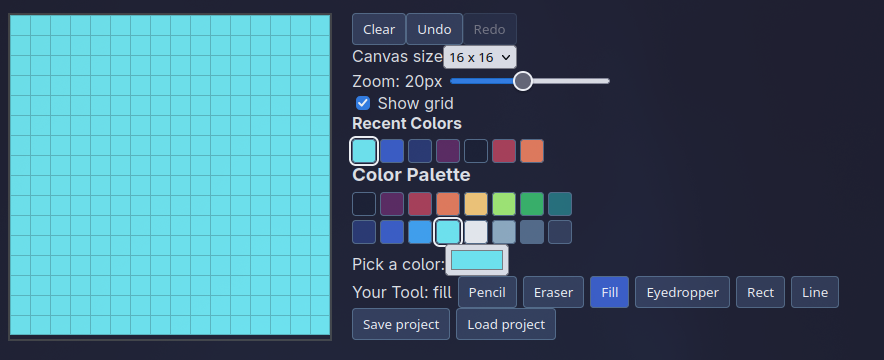

# Taint 

A pixel editor build in React, TypeScript and Vite.
Draw cool Pixelarts! 

Build for Terra. <3



## Demo 

https://taint-1k2w.vercel.app/

## Features 

- Tools: pencil, eraser, fill, eyedropper, line, rectangle
- 16 color pallete, custom color picker and recently used colors
- Undo / Redo
- Canvas Sizes
- Zoom and toggleable grid
- export and load JSON 
- ~~Export to png~~ It just dosnt work so I'm not including it now
- ~~Autosave in browser.~~ Also i dont know why it dosnt work so just leaving it for future me to do.

## Getting started 
```shell
git clone https://github.com/Tretaq/taint
npm install
npm run dev
```
## Todo 
For future me 

- Auto save is done just need to relize why its not working than add to Context
- export to png i think the fucntion is wrong 
- better css (its bad(its bad))
- keybinds for tools (no ones gonna use it rn)
